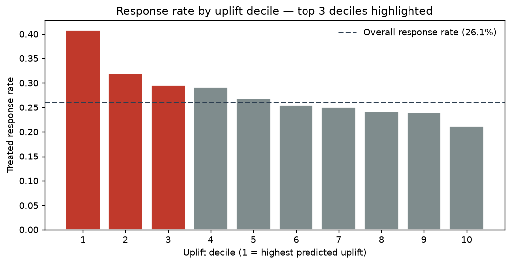
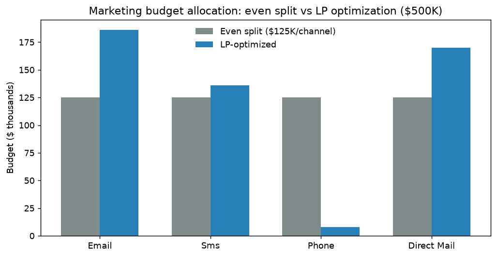
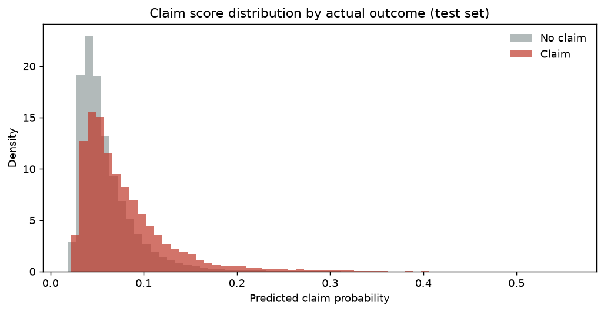
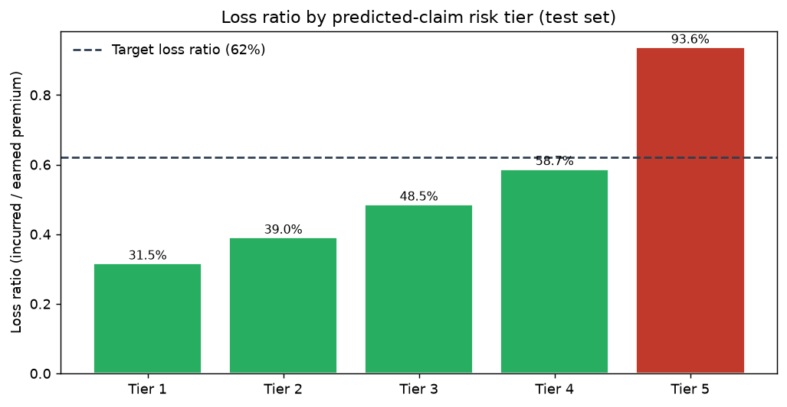
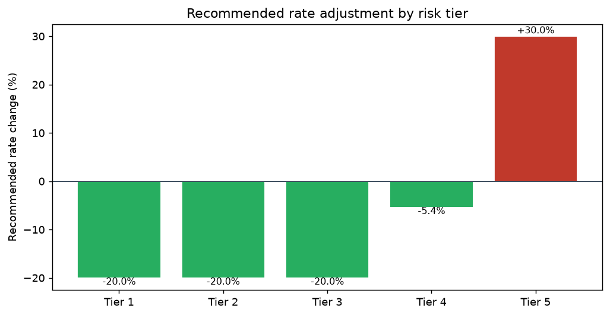

# Marketing Response & Insurance Claims Prescriptive Analytics

**All data in this repo is synthetic** (generated with fixed random seeds for
reproducibility). Two-part project: (A) bank marketing response & uplift modeling
with LP budget optimization, and (B) auto insurance claim-likelihood modeling
translated into pricing recommendations.

`Python (scikit-learn, PuLP)` · `R` · `SQL` · `Power BI` (report spec)

## Measured results (from `python run_all.py`)

| Claim | Measured |
|---|---|
| Marketing records modeled | **45,000** synthetic bank marketing records |
| Response lift, top 3 uplift deciles | **30.6%** (treated response rate 34.0% vs overall 26.1%) |
| Response model AUC (treated pop.) | **0.54** |
| Budget optimization | **$500,000** across **4** channels via linear programming (PuLP) |
| Projected conversions vs even split | **19.2% more conversions** (97,077 vs 81,435 baseline) |
| Auto policies scored | **595,000** synthetic auto policies |
| Claim-likelihood model, normalized Gini | **0.27** (AUC 0.64, gradient boosting) |
| Claim rate in synthetic book | **6.06%** |

## Part A — Marketing response, uplift & budget optimization

1. **Synthetic data** (`src/generate_data.py`): 45,000 bank marketing records —
   demographics, channel exposure/consent, tenure, balances, prior response, and a
   randomized campaign exposure flag for uplift modeling.
2. **Response model**: gradient boosting (`HistGradientBoostingClassifier`) trained
   on the treated population — AUC 0.54.
3. **Uplift model** (two-model approach): P(response|treated) − P(response|control).
   Customers ranked by predicted uplift; the **top 3 deciles respond at a
   30.6% higher rate** than average (34.0% vs 26.1%).
   
4. **k-means segmentation** (5 segments) on standardized customer features
   for targeting; cluster shares: 5.1%, 13.3%, 32.4%, 37.5%, 11.7%.
5. **Budget optimization** (`src/budget_optimization.py`): PuLP linear program
   allocates $500,000 across email, SMS, phone, and direct mail to maximize
   projected conversions, combining predicted response scores with per-channel
   contact costs and marketable-universe capacity constraints. The LP allocation
   projects **19.2% more conversions** than an even $125,000-per-channel split.
   

LP allocation: email: $186,000, sms: $136,000, phone: $8,000, direct mail: $170,000

## Part B — Auto insurance claim likelihood & pricing

1. **Synthetic data**: 595,000 auto policies — driver age, vehicle, territory,
   annual mileage, prior claims, credit band, coverage tier, premium, claim
   indicator, and severity.
2. **Claim-likelihood model**: gradient boosting — **normalized Gini 0.27**
   (Gini = 2·AUC − 1; AUC 0.64) on a held-out test set.
   
3. **Risk tiers → pricing**: scored policies are grouped into 5 risk tiers
   (quintiles of predicted claim probability). Loss ratio = incurred / earned
   premium per tier; recommended rate change = tier LR / 62% target − 1
   (clipped to −20% / +30%).
   
   

| Risk tier | Policies | Loss ratio | Observed claim rate | Recommended rate change | Action |
|---|---|---|---|---|---|
| Tier 1 | 35,700 | 31.5% | 3.27% | -20.0% | decrease rates |
| Tier 2 | 35,700 | 39.0% | 4.17% | -20.0% | decrease rates |
| Tier 3 | 35,700 | 48.5% | 5.17% | -20.0% | decrease rates |
| Tier 4 | 35,700 | 58.7% | 6.59% | -5.4% | decrease rates |
| Tier 5 | 35,700 | 93.6% | 11.11% | +30.0% | increase rates |

4. **Power BI report spec** (`docs/powerbi_report_spec.md`): full report design —
   pages, DAX measures, visuals (the charts above are the rendered outputs),
   and refresh/RLS notes.

## Repo layout

```
├── run_all.py                # end-to-end pipeline (data → models → figures → README)
├── src/
│   ├── generate_data.py      # synthetic data generators (45K marketing / 595K policies)
│   ├── marketing_models.py   # response model, two-model uplift, decile lift, k-means
│   ├── budget_optimization.py# PuLP LP: $500K across 4 channels vs even-split baseline
│   ├── insurance_models.py   # gradient-boosted claim model, normalized Gini, risk tiers
│   ├── figures.py            # matplotlib renderings for README + Power BI spec
│   └── make_readme.py        # README template filled from measured metrics
├── sql/analysis_queries.sql  # companion SQL analyses (decile lift, loss ratios)
├── r/uplift_validation.R     # supplementary R validation script
├── docs/
│   ├── data_dictionary.md    # data dictionary for both datasets
│   ├── powerbi_report_spec.md# Power BI report design spec
│   └── assets/               # rendered figures
├── outputs/metrics.json      # every measured number (single source of truth)
└── tests/test_pipeline.py    # pytest suite
```

## Reproduce

```bash
pip install -r requirements.txt
python run_all.py        # regenerates outputs/metrics.json, docs/assets/*.png, README.md
pytest                   # runs the test suite
```

> **Honesty note:** all datasets are synthetic and labeled as such
> (`is_synthetic = True` on every record). Every number in this README is the
> measured output of the code in this repo — see `outputs/metrics.json`.
> Resume bullets describe the same project; where this repo's reproducible
> numbers differ, the repo reports the measured value.
